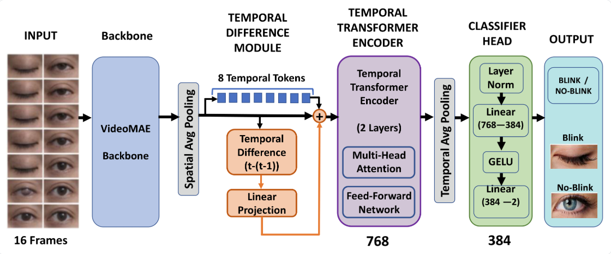

# BlinkVideoMAE

<p align="center"> <strong>BlinkVideoMAE: Token-Level Temporal Difference Modeling for In-the-Wild Eye Blink Detection</strong> </p>
<p align="center"> <strong>Abdelhakim Chergui</strong> · <strong>Belkacem Hedadi</strong> · <strong>Salah Eddine Bekhouche</strong> · <strong>Azeddine Benlamoudi</strong> </p>
<p align="center"> <em>Manuscript under submission.</em> </p>

BlinkVideoMAE fine-tunes a Kinetics-pretrained VideoMAE-Base backbone end-to-end and adds a compact
**Temporal Difference Module (TDM)**. TDM projects the residual between adjacent, spatially pooled
768-dimensional temporal tokens and adds it back, giving the network an explicit motion cue for the
open–closed–open trajectory of a blink, without optical flow. The model is evaluated on pre-cropped
32 × 32 eyes from **HUST-LBEW** (in-domain) and, trained only on HUST-LBEW, on **Epan-EyeBlink2**
(cross-dataset, no target labels).

<p align="center">
  
</p>

*A Kinetics-pretrained VideoMAE encodes 16 frames; spatial average pooling yields
eight temporal tokens; TDM residualizes adjacent-token motion; an MLP predicts blink or non-blink,
optionally preceded by a two-layer temporal Transformer. The main model of the paper omits the temporal
Transformer.*

## Repository layout

```
BlinkVideoMAE/
├── assets/
│   └── blinkvideomae_architecture.png
├── datasets/                            # downloaded separately; see datasets/README.md
│   ├── README.md
│   ├── HUST-LBEW/
│   └── Epan-EyeBlink2/
├── src/
│   ├── video_utils.py
│   ├── blink_model.py
│   ├── run_experiments.py
│   ├── run_videomae_baseline.py
│   ├── run_blinkvideomae_tdm_enc.py
│   └── outputs/
├── .gitignore
└── README.md
```

`src/` is flat on purpose: `video_utils.py` looks for the data in `../datasets/` (relative to `src/`), and
the scripts import their sibling modules by name.

## Setup

**Environment.** Install PyTorch and torchvision for your platform, then:

```bash
pip install transformers accelerate datasets numpy pandas scikit-learn pillow av opencv-python decord
```

**Data.** Both datasets are hosted on the Hugging Face Hub:
[`Bekhouche/HUST-LBEW`](https://huggingface.co/datasets/Bekhouche/HUST-LBEW) (training and in-domain test
crops) and [`Bekhouche/Epan-EyeBlink2`](https://huggingface.co/datasets/Bekhouche/Epan-EyeBlink2)
(cross-dataset test crops). The scripts read them from local folders, so download them into `datasets/`
from the repository root:

```bash
python -c "from huggingface_hub import snapshot_download as d; d('Bekhouche/HUST-LBEW', repo_type='dataset', local_dir='datasets/HUST-LBEW')"
python -c "from huggingface_hub import snapshot_download as d; d('Bekhouche/Epan-EyeBlink2', repo_type='dataset', local_dir='datasets/Epan-EyeBlink2')"
```

Splits, columns and the expected folder names are described in [`datasets/README.md`](datasets/README.md).

## Reproducing the experiments

Run from anywhere; each script adds its own folder to `sys.path`.

```bash
python src/run_experiments.py                                            # all seven experiments
python src/run_experiments.py --exp videomae_baseline ablate_temporal    # selected experiments
python src/run_videomae_baseline.py                                      # standalone VideoMAE baseline
python src/run_blinkvideomae_tdm_enc.py                                  # standalone TDM + Transformer model
```

`--exp` accepts any of the seven keys below:

| `--exp` key | Architecture |
|---|---|
| `videomae_baseline` | VideoMAE with a freshly initialized classification head; no TDM, no added temporal Transformer |
| `ablate_temporal` | VideoMAE + TDM; no added temporal Transformer |
| `ablate_tdm` | VideoMAE + two-layer temporal Transformer; no TDM |
| `blinkvideomae` | VideoMAE + TDM + two-layer temporal Transformer |
| `r3d18_baseline` | Kinetics-pretrained 3D ResNet-18 |
| `blinkvideomae_span10_tdm` | VideoMAE + TDM, no added temporal Transformer; native 10-frame clip span |
| `blinkvideomae_span10` | VideoMAE + TDM + two-layer temporal Transformer; native 10-frame clip span |

`run_videomae_baseline.py` and `run_blinkvideomae_tdm_enc.py` are standalone versions of
`videomae_baseline` and `blinkvideomae`.

Every run uses seed 42 (`set_seed(42)` and `TrainingArguments(seed=42)`). Output is written under
`src/outputs/`:

| Script | Output folder | Files |
|---|---|---|
| `run_experiments.py` | `src/outputs/experiments/<experiment>/` | `metrics.json`, `predictions/<experiment>_HUST.csv`, `predictions/<experiment>_Epan.csv`; plus `src/outputs/experiments/summary.json` |
| `run_videomae_baseline.py` | `src/outputs/model1/` | `predictions/Model1_HUST_Predictions.csv`, `predictions/Model1_Epan_Predictions.csv` |
| `run_blinkvideomae_tdm_enc.py` | `src/outputs/model2/` | `predictions/Model2_HUST_Predictions.csv`, `predictions/Model2_Epan_Predictions.csv` |

Each output folder also holds the Hugging Face Trainer checkpoints.
